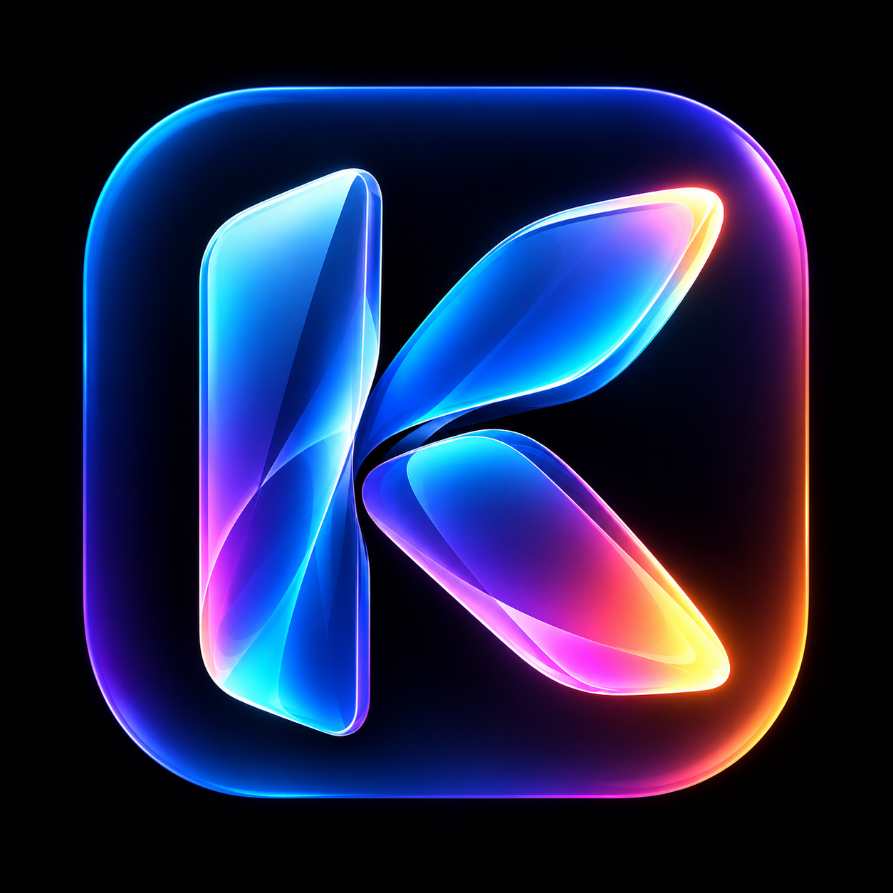
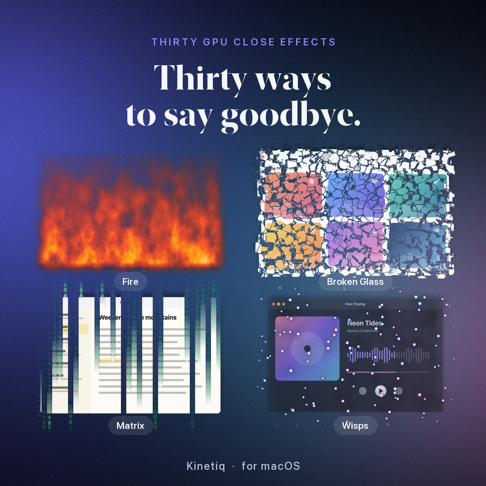
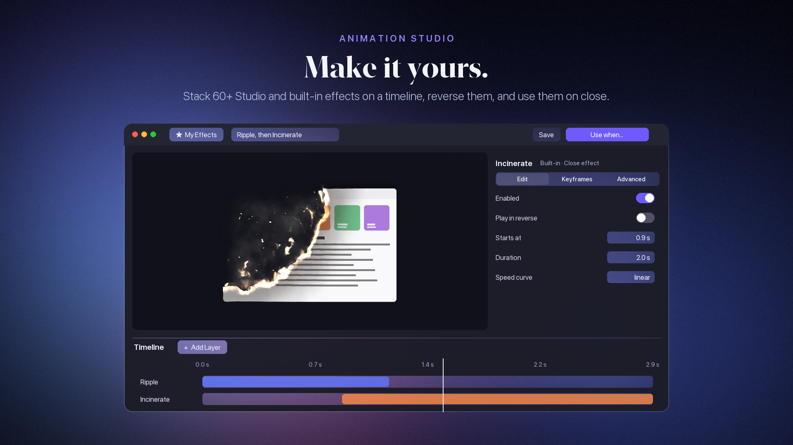
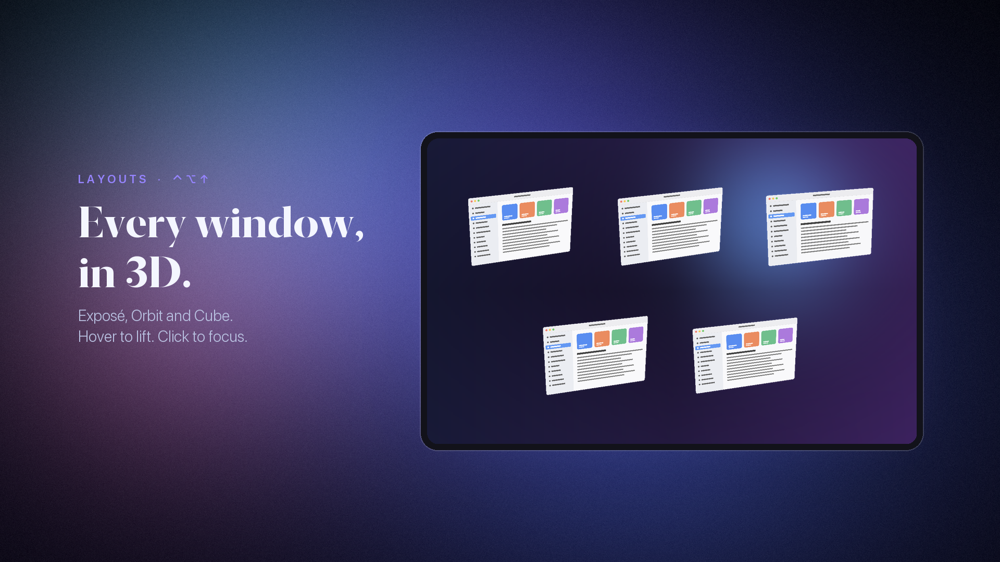
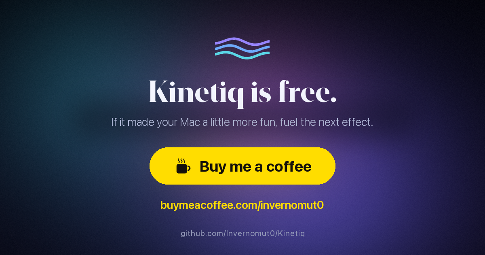

<p align="center">
  
</p>

<h1 align="center">Kinetiq</h1>

<p align="center">
  <b>Your Mac, in motion.</b><br>
  Compiz-style wobbly windows, 30+ GPU close effects, liquid and 3D window layouts for macOS.
</p>

<p align="center">
  <a href="https://github.com/Invernomut0/Kinetiq/releases/latest"></a>
  
  <a href="LICENSE"></a>
  <a href="https://buymeacoffee.com/invernomut0"></a>
</p>

https://github.com/user-attachments/assets/bdc6f7c0-842a-468f-934c-ed94370ca43c

<p align="center"><sub>Music: <i>Eternity</i> by Pufino · Free To Use Music (freetouse.com)</sub></p>

## What it does

- **Wobbly windows.** Drag a window by its title bar, or anywhere with ⌃⌘, and it wobbles like jelly on a real spring mesh, then settles where you drop it. Optional glide, 3D tilt, drop ripples and maximize/resize bounces.
- **Close effects.** 30 GPU shaders ported from Burn-My-Windows (Incinerate, Fire, Snap of Disintegration, Broken Glass, Matrix…), a desktop-space **Liquid** simulation and **Window Destruction**.
- **Open and minimize.** Six spring entrances and nine Dock morphs, from Genie to Whirlpool. ⌘M stays native.
- **Animation Studio.** Stack Studio and built-in effects on a timeline, reverse them, keyframe their parameters, save them to **My Effects** and use them when a window opens, closes or is minimized.
- **Layouts.** Press **⌃⌥↑** anywhere: windows fly into Exposé 3D, Orbit or Cube. Hover to lift, click to focus, Escape to put everything back.
- **Screen saver.** Optionally make Kinetiq's desktop-destruction scene the macOS screen saver.

Everything is chosen per event from the menu bar (**Drag**, **Open**, **Close**, **Minimize**) or from the Effects library, where every effect previews live before you use it.

<table>
  <tr>
    <td width="50%"></td>
    <td width="50%"><br><br></td>
  </tr>
</table>

## Install

Requires **macOS 14 or later** on Apple Silicon or Intel.

1. Download the latest `Kinetiq-x.y.z.dmg` from [Releases](https://github.com/Invernomut0/Kinetiq/releases/latest) (the DMG, not the source archive).
2. Drag **Kinetiq.app** to **Applications** and open it from there.
3. The app is not notarized. If macOS blocks it, open **System Settings → Privacy & Security** and choose **Open Anyway**.
4. Grant **Accessibility** (to follow drags and move windows) and **Screen Recording** (to capture the window being animated). Relaunch if macOS asks.

Kinetiq lives in the menu bar; closing its window does not quit it. The [install guide](docs/install.md) covers checksum verification, Gatekeeper and the quarantine attribute in detail.

## Getting started

| To… | Do this |
|---|---|
| Wobble a window | Drag it by the title bar, or hold ⌃⌘ and drag anywhere |
| Pick what plays on open, close or minimize | Menu bar → **Open / Close / Minimize**, or **Effects** in the app |
| Preview any effect | **Effects**: select it and it plays on a sample window (or one of yours) |
| Make your own effect | **Animation Studio** → Add Layer → Save → **Use when…** |
| See all windows in 3D | **⌃⌥↑**, or menu bar → **Arrange Windows** |
| Try any effect on the front window | Menu bar → **Try an Effect on the Front Window** |
| Exclude an app or give it its own close effect | **Rules** |

Wobbly also targets movable floating/modal panels, small windows and windows without
a close button. For custom or borderless windows, use **⌃⌘ + drag**; ordinary title-bar
drags leave buttons, tabs and text fields native. Accessibility and Screen Recording
must be granted, and the target must expose its exact movable window to macOS.
App exclusions (including Kinetiq itself), menus, locked-screen surfaces, full-screen
windows and nonmovable/protected popovers remain outside this support. This source
change is not included in the already-published v0.5.1 DMG.

The [user guide](docs/user-guide.md) explains every page, effect and setting. See also the [Animation Studio guide](docs/animation-studio.md) and the [list of built-in effects](docs/original-effects.md).

## Privacy

Effects run on your Mac: window captures used for animations stay in memory and are never sent anywhere. If you enable the screen saver, Kinetiq keeps a local desktop snapshot for it (never uploaded, deleted when you disable it); it can contain private content and appear on the lock screen.

Usage analytics are optional and **off by default**. They start only after you choose **Enable Analytics** and can be withdrawn in **Settings → Privacy & Analytics**. They use a pseudonymous ID and your Mac's configured country, and never include window titles, screenshots or documents. Details: [telemetry](docs/telemetry.md) and [user guide](docs/user-guide.md#optional-analytics).

## Build from source

Requires Xcode 26 or later and the reviewed `TelemetrySDK` checkout next to this repository (`../TelemetrySDK`, at the revision in `Documentation/telemetry-sdk-revision.txt`).

```sh
swift build
swift test
./scripts/build-app.sh        # universal, signed build/Kinetiq.app
```

The [building guide](docs/building.md) covers dependencies, packaging, analytics configuration and the source map. Release notes are in the [CHANGELOG](CHANGELOG.md) and the [detailed release history](docs/release-history.md).

## Support

Kinetiq is free and open source, made by one developer. If it made your Mac a little more fun:

<p align="center">
  <a href="https://buymeacoffee.com/invernomut0"></a>
</p>

## Credits

- The wobbly model comes from the Compiz wobbly plugin by David Reveman (Novell), with the spring model by Kristian Høgsberg.
- The physics, presets and resize effect are ported from the GNOME Shell extension [Compiz windows effect](https://github.com/hermes83/compiz-windows-effect) by Mauro Pepe.
- The trick for hiding the real window comes from [AeroSpace](https://github.com/nikitabobko/AeroSpace).
- The close effects, their settings and their textures come from [Burn-My-Windows](https://github.com/Schneegans/Burn-My-Windows) by Simon Schneegans: the GLSL shaders were ported to Metal. The brush, claws, dust, matrix font and shard textures are licensed CC-BY-4.0.
- Native screen saver selection uses [PaperSaverKit](https://github.com/AerialScreensaver/PaperSaver) 0.4.3 (MIT); the full notice is included in `NOTICE` and in the packaged app.
- Optional analytics uses the unchanged TelemetrySDK 0.1.1 generic core (MIT) and official Firebase Apple SDK 12.6.0, FirebaseCore + FirebaseAnalyticsCore. Firebase SDK source is Apache-2.0; prebuilt Analytics/GoogleAppMeasurement binaries are not relabeled as Apache or open source. Source notices and official binary copyright metadata accompany the main app; see `NOTICE`. The selected macOS Analytics ZIP contains no privacy resource bundle or binary terms file. Firebase is not linked to the screen saver or preview executable.

## License

Kinetiq is licensed under the [GNU General Public License v3.0 or later](LICENSE). The resize effect is ported from Compiz windows effect, and the close effects from Burn-My-Windows, which are GPL-3.0-or-later, so Kinetiq is a derivative work under the same license. Third-party notices are in [NOTICE](NOTICE).
